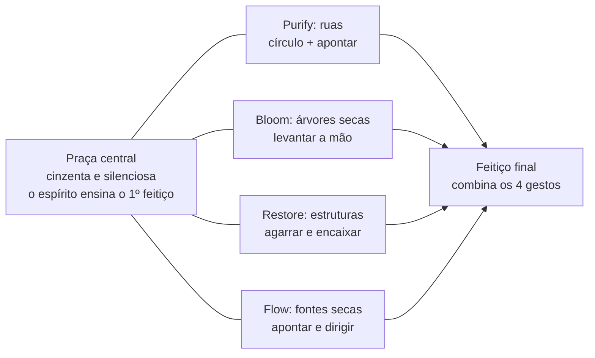

# Arcane Restoration: The Forgotten City

Experiência em Realidade Virtual (projeto de RVA, FEUP) em que o jogador é um feiticeiro que chega a uma cidade que perdeu a sua energia vital. As ruas estão sujas, os edifícios danificados, as árvores secas e as fontes vazias. Com gestos e uma varinha (sem botões para lançar feitiços), o jogador restaura a cidade: as ruas ficam limpas, a vegetação volta, as casas recuperam a cor e os habitantes regressam.

A mensagem da experiência é a recuperação ambiental, a esperança e o impacto positivo das nossas ações. Não há violência: o feiticeiro só limpa, repara e cura.

---

## Sumário

- [Os quatro feitiços](#os-quatro-feitiços)
- [Estrutura da experiência](#estrutura-da-experiência)
- [Stack técnica](#stack-técnica)
- [Como abrir o projeto](#como-abrir-o-projeto)
- [Ponto de partida: as cenas do template](#ponto-de-partida-as-cenas-do-template)
- [Organização do projeto e regras de Git](#organização-do-projeto-e-regras-de-git)
- [Divisão da equipa](#divisão-da-equipa)
- [Roadmap](#roadmap)
- [Abordagem técnica por feitiço](#abordagem-técnica-por-feitiço)
- [Critérios de avaliação](#critérios-de-avaliação)
- [Pontos a confirmar](#pontos-a-confirmar)
- [Créditos de assets](#créditos-de-assets)

---

## Os quatro feitiços

O sistema de magia é a componente mais importante da avaliação (**interação, 8 pts**).

| Feitiço | O que o jogador faz | Interação |
|---|---|---|
| **Purify** (limpeza) | Desenha um círculo com a varinha e cria um pequeno tornado mágico que recolhe lixo, pó e destroços espalhados pelas ruas. | Gesto circular + apontar |
| **Bloom** (natureza) | Aponta para árvores secas, mantém o feitiço e levanta a mão devagar. As árvores crescem, aparecem flores e os jardins ganham vida. | Movimento da mão para cima |
| **Restore** (reparação) | Recolhe fragmentos de estruturas danificadas, encaixa-os no lugar certo e usa magia para reconstruir a estrutura. | Agarrar, mover, rodar e encaixar peças |
| **Flow** (água) | Dirige um jato de água mágica para fontes secas, limpa canais e devolve vida aos espaços públicos. | Apontar a varinha e controlar a direção do fluxo |

Quando as quatro zonas estão restauradas, aparece um **feitiço final** que combina os quatro movimentos e restaura a praça por completo.

## Estrutura da experiência

Em vez de uma cidade enorme, o projeto é **uma praça central com quatro zonas interativas** (uma por feitiço), para a equipa se concentrar na qualidade.



1. O jogador começa numa cidade cinzenta e silenciosa.
2. Um pequeno espírito mágico apresenta a missão e ensina o primeiro feitiço.
3. O jogador move-se livremente e restaura as zonas pela ordem que quiser.
4. Com as quatro zonas restauradas, o feitiço final dá vida à praça inteira.

**O que torna a experiência especial:**

- **Transformação em tempo real:** cada feitiço muda a cena na hora, com partículas, animações e cor.
- **Feedback mágico:** a varinha vibra, faz som e muda de cor conforme o feitiço.
- **A cidade responde:** os pássaros voltam, as luzes acendem, a música evolui e os habitantes aparecem.

## Stack técnica

| Componente | Versão |
|---|---|
| Unity | **6000.4.0f1** (Unity 6.4), template **VR** |
| Render pipeline | URP 17.4.0 |
| XR Interaction Toolkit | 3.4.1 (com Starter Assets e Hands Interaction Demo) |
| OpenXR / Meta OpenXR | 1.16.1 / 2.5.0 |
| XR Hands | 1.7.3 |
| Input System | 1.19.0 |
| Headset alvo | Meta Quest (headsets do GIG) |

## Como abrir o projeto

1. Instalar o **Unity 6000.4.0f1** pelo Unity Hub com o módulo **Android Build Support** (incluindo *OpenJDK* e *Android SDK & NDK Tools*).
2. Clonar o repositório.
3. No Unity Hub: **Add → Add project from disk** e escolher a pasta clonada (a raiz do repositório é o projeto Unity).
4. A primeira abertura demora, porque o Unity recria a pasta `Library/`.
5. Para testar no headset durante o desenvolvimento: ligar o Quest ao PC com **Quest Link / Air Link** e carregar em Play no Editor. Só é preciso gerar APK para testes standalone e para a entrega.
6. Confirmar em **Project Settings → XR Plug-in Management** que o **OpenXR** está ativo nas abas *Windows* e *Android*, e que o feature group **Meta Quest** está ativo na aba *Android*.

## Ponto de partida: as cenas do template

O template VR já traz bastante coisa que o projeto vai usar:

| Caminho | O que é | O que fazer |
|---|---|---|
| `Assets/Scenes/SampleScene` | Cena de demonstração/tutorial do template | Usar **só como referência** para ver como as coisas estão ligadas. Não construir o jogo em cima dela. |
| `Assets/Scenes/BasicScene` | Cena limpa com XR Origin e chão | **Duplicar** para `Assets/_Project/Scenes/Plaza.unity`. É a base da praça. |
| `Assets/Samples/XR Interaction Toolkit/3.4.1/Starter Assets` | `XR Origin (XR Rig)`, teleporte, interactors, input actions | **Não apagar.** O XR Origin depende daqui. A `DemoScene` mostra exemplos de grab e socket. |
| `Assets/Samples/XR Hands` | Visualização das mãos | Manter (opcional para o projeto). |
| `Assets/VRTemplateAssets` | Modelos, materiais e áudio da demo | Podem ser removidos no fim, se não forem usados (verificar referências antes). |

Antes de começar, vale a pena fazer o tutorial **Quick Start Guide VR** (painel *Tutorials* do Editor).

## Organização do projeto e regras de Git

Todo o conteúdo nosso fica em `Assets/_Project/`, separado do template e dos assets de terceiros:

```
Assets/_Project/
├── Scenes/
│   ├── Plaza.unity          ← cena principal
│   ├── MainMenu.unity
│   └── Sandbox/             ← uma cena de testes por pessoa
├── Scripts/
│   ├── Magic/               ← varinha, gestos, feitiços
│   ├── World/               ← zonas, RestorationManager, habitantes
│   └── UI/
├── Prefabs/
├── Materials/
├── VFX/
├── Audio/
└── Models/
```

**Regras para evitar conflitos (cenas Unity são difíceis de fazer merge):**

- Cada pessoa trabalha na sua cena `Sandbox/Sandbox_<Nome>.unity` e em **prefabs**.
- Só uma pessoa de cada vez edita a `Plaza.unity`. Avisar no grupo antes de mexer.
- Fazer commit sempre com os ficheiros `.meta` correspondentes.
- Nunca commitar `Library/`, `Temp/`, `Logs/`, `UserSettings/` nem builds (o `.gitignore` já trata disto).
- Fazer pull antes de começar e commits pequenos e frequentes.

## Divisão da equipa

| Pessoa | Foco | Inclui |
|---|---|---|
| 1 · _(nome)_ | Magia e interação | Varinha, reconhecimento de gestos, os quatro feitiços e o feitiço final, feedback nos comandos |
| 2 · _(nome)_ | Mundo e modelos | Praça e quatro zonas, lixo, estruturas, árvores, fontes, animações, habitantes |
| 3 · _(nome)_ | UI, sistemas e polimento | Menu inicial, widgets, tutorial do espírito, progresso e pontuação, áudio, relatório e vídeo |

## Roadmap

> Datas pensadas para uma entrega a **18 de dezembro de 2026**. A data ainda tem de ser confirmada com o professor (ver [Pontos a confirmar](#pontos-a-confirmar)).
>
> Regra de ouro: **uma praça pequena e bem feita vale mais do que uma cidade grande e vazia.**

### Fase 0: Setup (20 a 22 de novembro)

- [x] Criar o projeto Unity com o template VR (6000.4.0f1)
- [x] `.gitignore` para Unity
- [ ] Validar o conceito com o professor e confirmar a data de entrega
- [ ] Reservar os headsets do GIG em <https://s.up.pt/rucw> (indicar que somos alunos de RVA)
- [ ] Toda a equipa clona e abre o projeto (com Android Build Support instalado)
- [ ] Configurar o XR Plug-in Management (OpenXR + Meta Quest) e testar a `SampleScene` no Quest
- [ ] Fazer o tutorial *Quick Start Guide VR* do template
- [ ] Criar a estrutura `Assets/_Project/` e a cena `Plaza.unity` a partir da `BasicScene`

### Fase 1: Fundações e vertical slice (23 a 29 de novembro)

- [ ] Greybox da praça central e das quatro zonas (formas simples, escala real)
- [ ] Navegação: teleporte, movimento contínuo e snap turn (XR Origin do template)
- [ ] Varinha: prefab agarrável que fica na mão, com um transform `Tip` na ponta
- [ ] Base do reconhecimento de gestos: registar o trajeto da ponta da varinha
- [ ] `RestorationManager`: progresso por zona (0 a 1) e percentagem global
- [ ] Estado "cidade cinzenta": saturação global (Volume → *Color Adjustments*) ligada à percentagem restaurada
- [ ] **Purify de ponta a ponta** como vertical slice (gesto → efeito → o lixo desaparece → a zona avança)

### Fase 2: Os quatro feitiços (30 de novembro a 6 de dezembro)

- [ ] **Bloom:** apontar para a árvore, manter o gatilho, levantar a mão → a árvore cresce e aparecem flores
- [ ] **Restore:** fragmentos agarráveis e encaixes na posição certa → a estrutura é reconstruída
- [ ] **Flow:** jato de água a sair da ponta da varinha, direção dada pela varinha e caudal pelo gatilho → as fontes enchem
- [ ] Feedback por feitiço: cor da varinha, vibração e som
- [ ] Seletor de feitiço (widget no pulso ou menu radial)
- [ ] Cada zona com um "antes e depois" bem visível

### Fase 3: Mundo, vida e UI (7 a 13 de dezembro)

- [ ] Substituir o greybox por modelos (Asset Store / Blender) e registar os [créditos](#créditos-de-assets)
- [ ] Animações de crescimento, água e reconstrução
- [ ] A cidade responde: pássaros, luzes, música por camadas, habitantes
- [ ] Espírito mágico do tutorial (apresenta a missão e ensina o primeiro feitiço)
- [ ] Menu inicial: escolher zona, dificuldade ou conjunto de feitiços
- [ ] Widgets no mundo: percentagem restaurada, hora do dia, lixo e água restantes
- [ ] Voo como opção de navegação
- [ ] **Feitiço final** (os quatro gestos em sequência) e a sequência final da praça

### Fase 4: Polimento e entrega (14 a 18 de dezembro)

- [ ] Performance no Quest (alvo de 72 fps): lightmaps, LODs, poucas luzes em tempo real, partículas leves
- [ ] Playtests com pessoas de fora e afinação da tolerância dos gestos
- [ ] Build final (APK) testada no headset
- [ ] Relatório e vídeo de demonstração
- [ ] Lista de créditos de assets completa

## Abordagem técnica por feitiço

Ponto de partida sugerido, a ajustar durante o desenvolvimento.

| Feitiço | Implementação sugerida |
|---|---|
| **Purify** | Enquanto o gatilho está premido, guardar a posição da ponta da varinha a cada frame. Detetar o círculo somando o ângulo percorrido à volta do centro do trajeto (≥ ~300°) e verificando que o raio é estável. Depois, apontar (raycast) para escolher onde nasce o tornado, que atrai os objetos de lixo (Rigidbody com tag `Trash`) e os faz desaparecer. |
| **Bloom** | Raycast da varinha para escolher a árvore. Com o gatilho premido, a subida da mão (Δy desde o início) dá um valor entre 0 e 1 que controla o crescimento (escala, blend shapes ou *normalized time* de um Animator). |
| **Restore** | `XRGrabInteractable` nos fragmentos e `XRSocketInteractor` nos encaixes, com filtro por tipo de peça. Quando todos os encaixes estão ocupados, dispara o efeito de reconstrução. |
| **Flow** | Particle System com colisões (ou LineRenderer) a sair da ponta da varinha. O valor analógico do gatilho controla o caudal. O colisor de cada fonte acumula água e faz subir o nível. |
| **Final** | Reconhecer os quatro gestos em sequência dentro de uma janela de tempo. |
| **Feedback** | Háptica do XRI (`HapticImpulsePlayer`), emissão do material da varinha com a cor de cada feitiço e um `AudioSource` na ponta. |

## Critérios de avaliação

| Critério | Como o projeto responde |
|---|---|
| **Interação (8 pts)** | Feitiços com gestos da varinha em vez de botões: círculo, levantar a mão, agarrar e encaixar, apontar e dirigir. Feitiço final que combina os quatro. |
| **Modelação e animação (5 pts)** | Lixo, peças de edifícios, árvores que crescem, fontes com água, pássaros e habitantes. Tudo reage aos feitiços. Assets da Asset Store devidamente referenciados. |
| **Criatividade (5 pts)** | Praça cinzenta e silenciosa que ganha cor, luz e vida. O contraste "antes e depois" conta para o aspeto visual. |
| **Navegação** | Teleporte ou movimento contínuo pela praça, com voo como opção. Ultrapassa os limites do espaço físico. |
| **Menus e widgets** | Menu inicial e widgets no mundo (seletor de feitiço, hora do dia, percentagem restaurada, lixo e água). |

## Pontos a confirmar

- [ ] **Conceito:** discutir a proposta com o professor antes de avançar.
- [ ] **Data de entrega:** o enunciado indica 18-Dez-2025, provavelmente uma gralha. Confirmar a data real.
- [ ] **Hardware:** reservar cedo os headsets do GIG em <https://s.up.pt/rucw>.

## Créditos de assets

Todos os assets de terceiros têm de ficar aqui registados.

| Asset | Autor | Link | Licença | Usado em |
|---|---|---|---|---|
| VR Template | Unity Technologies | Incluído no Unity Hub | Unity Companion License | Base do projeto, XR Origin |
| _(adicionar)_ | | | | |
